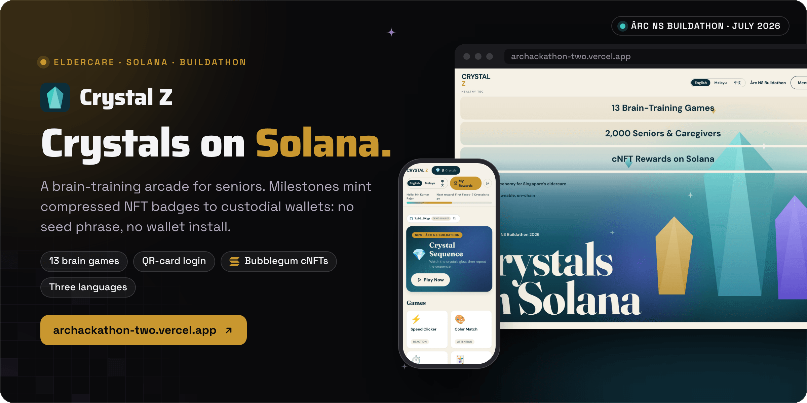

<div align="center">



<br><br>

<a href="https://archackathon-two.vercel.app"></a>&nbsp;&nbsp;
<a href="docs/DEMO_SCRIPT.md"></a>&nbsp;&nbsp;
<a href="docs/ARCHITECTURE.md"></a>

<br><br>

<a href="https://github.com/operatoruplift/archackathon/actions/workflows/ci.yml"></a>
<a href="https://archackathon-two.vercel.app"></a>


<a href="LICENSE"></a>

<h3>Play a game. Earn Crystals. Own the badge.</h3>

<b>Tap</b> &nbsp;→&nbsp; <b>Play</b> &nbsp;→&nbsp; <b>Guard</b> &nbsp;→&nbsp; <b>Earn</b> &nbsp;→&nbsp; <b>Mint</b> &nbsp;→&nbsp; <b>Verify</b>

<br>

<a href="#how-it-works">How it works</a> &nbsp;·&nbsp;
<a href="#status">Status</a> &nbsp;·&nbsp;
<a href="#run-it-locally">Run it locally</a> &nbsp;·&nbsp;
<a href="#documentation">Docs</a>

</div>

<br>

<picture>
  <source media="(prefers-color-scheme: dark)" srcset="docs/readme/screens-dark.png">
  
</picture>

<p align="center"><sub>Captured from a local production build (<code>npm run build</code>, served statically) in Demo Mode on 30 October 2026, playing Crystal Sequence as the demo persona Mr. Kumar Rajan. The mint is simulated: no devnet transaction was sent.</sub></p>

**Crystal Z is a brain-training arcade for seniors, and this repository adds a Solana reward layer to it: Crystals earned in play become milestone badges, minted as compressed NFTs to a wallet the player never has to manage.** Players sign in with a QR card, play short cognitive games in English, Malay or Chinese, and earn one Crystal per ten points. A Postgres score guard runs before any Crystal is awarded, the mint function recomputes the balance before minting, and custodial keys are generated server-side and encrypted at rest. With no configuration, the whole loop runs as a Demo Mode on local state.

Built by Matt ([RVAClassic](https://x.com/rvaclassic), [Operator Uplift](https://operatoruplift.com)) with Healthy Tec (NZmark Pte Ltd), whose Crystal Z arcade it extends, at the Ârc NS Buildathon, July 2026.

<br>

## How it works

<picture>
  <source media="(prefers-color-scheme: dark)" srcset="docs/readme/flow-dark.png">
  
</picture>

<table>
  <tr valign="top">
    <td width="33%"><b>Guard before value</b><br><sub><code>guard_score_insert()</code> rejects a score above the game's maximum, a game finished faster than its minimum duration, or too many games a minute. The limits live in the <code>games</code> table and in <code>src/lib/constants.ts</code>, and a test fails CI if they drift.</sub></td>
    <td width="33%"><b>The server decides the milestone</b><br><sub>The <code>mint-reward-cnft</code> edge function recomputes the Crystal balance before it mints, so a spoofed call cannot claim an unearned tier, and <code>unique(user_id, milestone_tier)</code> makes each mint idempotent.</sub></td>
    <td width="33%"><b>No seed phrases</b><br><sub>Keypairs are created lazily on the server and stored AES-GCM encrypted in a table with no client policies. Receiving a cNFT needs no signature from the player.</sub></td>
  </tr>
</table>

The same UI runs on two data providers in <code>src/lib/provider/</code>. The **supabase** provider is the production path above. The **demo** provider keeps everything in <code>localStorage</code> with three staged QR personas and the same guard logic, and simulates the mint unless the Vercel mint API is configured. The UI cannot tell them apart; <code>getProvider()</code> picks one from the environment.

<p align="center"><sub>React 18 · Vite 5 · TypeScript · Tailwind CSS 3 · TanStack Query · i18next · Supabase (Postgres, RLS, Auth, Edge Functions) · Metaplex Bubblegum 4 · umi · Solana devnet · Vitest · Vercel</sub></p>

<br>

## Status

<table>
  <tr valign="top">
    <td width="16%" align="center"></td>
    <td>Built at the Ârc NS Buildathon, which the project's docs date to 11 and 12 July 2026 and describe as a 9-hour build. In that time box it added the 13th game (Crystal Sequence), the server-side score guard, custodial wallets, the <code>mint-reward-cnft</code> edge function, milestone cNFTs and the My Rewards page. The code landed on 11 July 2026 as one commit plus three deployment fixes. No result is recorded.</td>
    <td width="22%"><a href="docs/PITCH.md">Judging pitch</a></td>
  </tr>
  <tr valign="top">
    <td align="center"></td>
    <td>Built with and for Healthy Tec (NZmark Pte Ltd), which runs the Crystal Z arcade and holds the copyright on this code. Product figures in the pitch are the team's own and are not restated here.</td>
    <td><a href="https://healthy-tec.com">healthy-tec.com</a></td>
  </tr>
  <tr valign="top">
    <td align="center"></td>
    <td><a href="https://archackathon-two.vercel.app">archackathon-two.vercel.app</a> serves <code>main</code> (commit <code>38f5aea</code>, deployed 11 July 2026, ready when checked on 30 October 2026) in Demo Mode: the Vercel project sets no environment variables, so logins use the demo personas and mints are simulated.</td>
    <td><a href="https://archackathon-two.vercel.app">Open the demo</a></td>
  </tr>
  <tr valign="top">
    <td align="center"></td>
    <td>Real devnet mints are implemented three ways: the setup and mint-test scripts, the Supabase edge function, and the Vercel fallback API. They need a funded payer, a Merkle tree and a collection from <code>npm run solana:setup</code>. None ran for this README, and the repository records no tree, collection or mint addresses.</td>
    <td><a href="docs/DEPLOYMENT.md">Deployment tiers</a></td>
  </tr>
  <tr valign="top">
    <td align="center"></td>
    <td>From the pitch: monthly-champion voucher cNFTs, Honeycomb missions, sponsor-funded reward pools, server-authoritative game sessions and anomaly detection, and mainnet only after that hardening.</td>
    <td><a href="docs/PITCH.md">What's next</a></td>
  </tr>
</table>

<br>

## Run it locally

<table>
  <tr valign="top">
    <td width="33%"><b>Prerequisites</b><br><sub>Node 20 or newer and npm. For real mints, a devnet RPC; for the full path, the Supabase CLI and a Supabase project.</sub></td>
    <td width="33%"><b>Read first</b><br><sub><a href="docs/DEPLOYMENT.md">Deployment</a>: three tiers, from zero-config Demo Mode to real devnet mints to the full Supabase path.</sub></td>
    <td width="33%"><b>What the checks prove</b><br><sub>31 Vitest tests: game logic, the score guard, milestones, and parity between the client limits, the SQL seed and the three locales. <a href=".github/workflows/ci.yml">CI</a> runs typecheck, tests and build on every push and pull request.</sub></td>
  </tr>
</table>

### 1. Run the arcade in Demo Mode

```bash
npm install
cp .env.example .env.local   # leave it blank for Demo Mode
npm run dev                  # http://localhost:5173
```

Pick a demo QR card, open **Crystal Sequence** from the NEW banner and score 70 or more to cross the first milestone as Mr. Kumar Rajan. The [demo script](docs/DEMO_SCRIPT.md) has the full click path and fallbacks.

### 2. Check it

```bash
npm run typecheck   # app and node configs
npm test            # 31 Vitest tests
npm run build       # typecheck, then the Vite production build into dist/
```

### 3. Mint for real on devnet

```bash
npm run solana:setup       # payer, Merkle tree (depth 14) and collection; prints the env values
npm run solana:mint-test   # one mint, with explorer links for the transaction and asset
npm run solana:verify      # reads an asset back through a DAS-capable RPC (VITE_DAS_RPC_URL)
```

Then either set the mint variables on Vercel, so the deployed demo mints real devnet cNFTs without Supabase, or take the full path: `supabase db push` with `supabase/seed.sql`, `supabase functions deploy mint-reward-cnft qr-auth-validate`, and `supabase secrets set` for the values below. [Deployment](docs/DEPLOYMENT.md) has every step.

| Variable | Where | Purpose |
|---|---|---|
| `VITE_SUPABASE_URL`, `VITE_SUPABASE_ANON_KEY` | Vite | Switch the app from Demo Mode to the Supabase provider |
| `VITE_DAS_RPC_URL` | Scripts | DAS-capable devnet RPC used by `npm run solana:verify` (the public devnet RPC has no DAS) |
| `SOLANA_RPC_URL` | Vercel API, edge function, scripts | Devnet RPC for minting |
| `MERKLE_TREE_ADDRESS`, `COLLECTION_MINT_ADDRESS` | Vercel API, edge function | The tree and collection created by `solana:setup` |
| `PAYER_SECRET_KEY` | Vercel API, edge function | Base58 secret of the funded devnet payer. Devnet only; never commit it |
| `PUBLIC_BASE_URL` | Vercel API, edge function, scripts | Origin for badge metadata URIs. Unset, the Vercel API uses the request's host, and the edge function and scripts use `archackathon-operatoruplift.vercel.app` |
| `MINT_ALLOWED_ORIGIN` | Vercel API | CORS origin allowed to call the mint API; `*` when unset |
| `WALLET_ENC_KEY` | Edge function | 32-byte base64 key for AES-GCM custodial wallet encryption |

The Vercel fallback API is demo-grade by design: it mints the tier the client asks for, limited to five requests a minute per IP. The Supabase edge function is the path that verifies balances.

<details>
<summary><b>Architecture, as text</b></summary>
<br>

```
Player (QR card, EN / MS / ZH)
   │  plays 1 of 13 games
   ▼
scores INSERT ──▶ guard_score_insert()      BEFORE: max score, min duration, rate limit
   │             award_crystals_for_score() AFTER:  +FLOOR(score / 10) Crystals
   ▼
user_crystals ledger (append-only, RLS)
   │  threshold crossed
   ▼
mint-reward-cnft edge function: verifies the balance server-side
   │  Metaplex Bubblegum mintToCollectionV1, fee paid by the ops payer
   ▼
cNFT to the custodial wallet: "My Rewards" + Solana Explorer link
```

Full details, including the custody model and the provider seam: [docs/ARCHITECTURE.md](docs/ARCHITECTURE.md).

</details>

<details>
<summary><b>Repository layout</b></summary>
<br>

| Path | Contents |
|---|---|
| `src/` | The React app: landing portal, QR login, arcade, 13 games, rewards, i18n and the demo or Supabase providers |
| `supabase/` | Migrations (schema, RLS, triggers), seed data, and the `mint-reward-cnft` and `qr-auth-validate` edge functions |
| `solana/` | Devnet provisioning, mint and verify scripts (umi, Bubblegum) |
| `api/` | The Vercel serverless mint fallback |
| `public/cnft/` | Badge art and metadata for the four milestone tiers and the monthly-champion tier |
| `tests/` | Vitest: game logic, score guard, milestones, SQL and i18n parity |
| `docs/` | Architecture, pitch, demo script and deployment guide |

</details>

<br>

## Documentation

<table>
  <tr valign="top">
    <td width="33%"><b>Understand it</b><br><sub><a href="docs/ARCHITECTURE.md">Architecture</a>: layers, end-to-end flow, custody model, provider seam and security posture</sub></td>
    <td width="33%"><b>Run it</b><br><sub><a href="docs/DEPLOYMENT.md">Deployment</a>: Demo Mode, real devnet mints, the full Supabase path and a verification checklist</sub></td>
    <td width="33%"><b>Show it</b><br><sub><a href="docs/DEMO_SCRIPT.md">Demo script</a>: the two-minute click path<br><a href="docs/PITCH.md">Pitch</a>: the three-minute judging pitch</sub></td>
  </tr>
</table>

<br>

<p align="center"><sub>MIT licensed, copyright 2026 NZmark Pte Ltd (see <a href="LICENSE">LICENSE</a>). Devnet only: badges carry no monetary value.</sub></p>

<p align="center"><sub>Built by <a href="https://rvaclassic.xyz">Matt Sim</a>, founder of <a href="https://operatoruplift.com">Operator Uplift</a>. More builds at <a href="https://github.com/operatoruplift">github.com/operatoruplift</a>. Want one built for your product? <a href="https://cal.com/rvaclassic/15min">Book a 15-minute call</a>.</sub></p>
